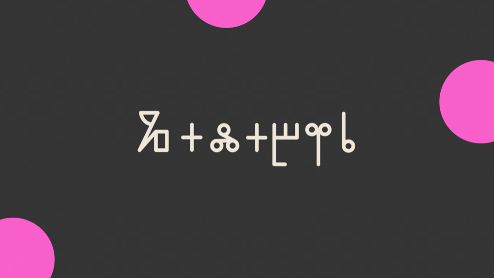
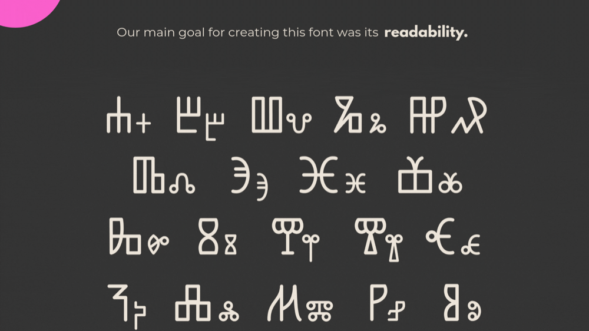
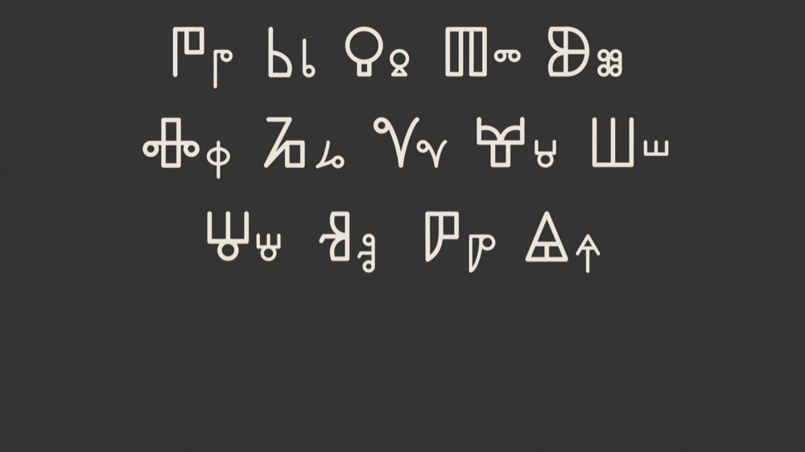
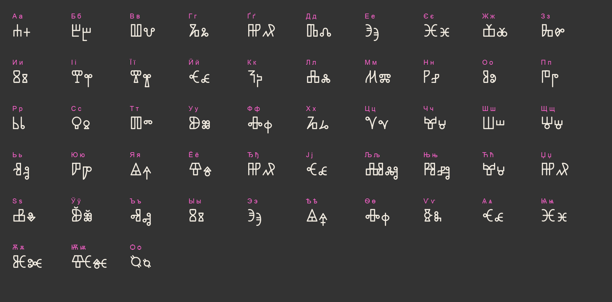

# Galabir



**Galabir** — читабельний глаголичний шрифт для українського тексту.
**Galabir** is a readable Glagolitic typeface for Ukrainian and other Cyrillic Slavic languages.

[🇺🇦 Українська](#українська) · [🇬🇧 English](#english) · [Таблиця символів](#таблиця-символів--character-map) · [Specimen](https://kosoglotoff-netizen.github.io/galabir/) · [Behance](https://www.behance.net/gallery/244865775/Galabir)

---

## Українська

### Про шрифт

Сучасні глаголичні шрифти важко читати: здебільшого в них немає виносних елементів
(асцендерів і десцендерів), немає різниці між великими та малими літерами, а багато
знаків надто схожі між собою.

Головна мета Galabir — **читабельність**. Для цього ми застосували принцип латинки,
де великі й малі літери походять з різних стилів письма:

- **великі літери** — з **кутастої (хорватської) глаголиці**;
- **малі літери** — з **круглої (болгарської) глаголиці**;
- **виносні елементи й хвостики** — запозичені з **глаголичного скоропису**.

У результаті текст, набраний Galabir, читається значно легше, ніж в інших глаголичних шрифтах.

Шрифт створено на основі відкритого шрифту [League Spartan](https://github.com/theleagueof/league-spartan)
для української мови. Він також підходить для інших слов'янських мов, що використовують кирилицю:
болгарської, сербської, білоруської, македонської, чорногорської.




### Як це працює

Набирайте звичайним **кириличним** текстом, і шрифт покаже його **глаголицею**.
Нічого перемикати не треба: «Слава Україні» у Galabir одразу виглядає глаголичним написом.
Латинські літери, цифри й розділові знаки залишаються з League Spartan.

| | |
|---|---|
| Накреслення | Light (300) |
| Версія | 4.0 |
| Формати | TTF (для встановлення), WOFF2 (для вебу) |

### Завантажити та встановити

1. Відкрийте сторінку [**Releases**](https://github.com/kosoglotoff-netizen/galabir/releases/latest) і завантажте `Galabir.zip`.
2. Розпакуйте архів.
3. Встановіть шрифт:
   - **macOS** — двічі клацніть файл `.ttf` → «Встановити шрифт»;
   - **Windows** — правою кнопкою на файлі `.ttf` → «Встановити для всіх користувачів»;
   - **Linux** — скопіюйте файл у `~/.local/share/fonts/` і виконайте `fc-cache -f`.

Після встановлення шрифт з'явиться у Figma, Word, Photoshop та інших програмах.

### Використання на сайті

Додайте в `<head>`:

```html
<link rel="stylesheet" href="https://cdn.jsdelivr.net/gh/kosoglotoff-netizen/galabir@latest/css/galabir.css">
```

і використовуйте в CSS:

```css
.glagolitic {
  font-family: "Galabir", sans-serif;
}
```

Або підключіть файл шрифту напряму:

```css
@font-face {
  font-family: "Galabir";
  src: url("https://cdn.jsdelivr.net/gh/kosoglotoff-netizen/galabir@latest/fonts/Galabir-Light.woff2") format("woff2");
  font-weight: 300;
  font-style: normal;
  font-display: swap;
}
```

> Щоб зафіксувати конкретну версію, замініть `@latest` на номер релізу, наприклад `@v1.0.0`.

### Ліцензія

Galabir поширюється за ліцензією **[SIL Open Font License 1.1](OFL.txt)**: його можна вільно
використовувати, зокрема в комерційних проєктах, змінювати й поширювати. Продавати сам шрифт
окремо не можна. Похідні шрифти теж мають виходити під OFL.

---

## English

### About

Modern Glagolitic fonts are hard to read: most have no ascenders or descenders,
no distinction between uppercase and lowercase, and many letters look too similar in running text.

Galabir's main goal is **readability**. We borrowed the Latin-script approach, where uppercase
and lowercase come from different writing styles:

- **uppercase** is based on **Angular (Croatian) Glagolitic**;
- **lowercase** is based on **Round (Bulgarian) Glagolitic**;
- **ascenders, descenders and tails** come from **Glagolitic cursive**.

The result is a Glagolitic typeface that is much more readable and accessible.

Galabir is built on the open-source [League Spartan](https://github.com/theleagueof/league-spartan)
and designed for Ukrainian. It also suits other Cyrillic Slavic languages: Bulgarian, Serbian,
Belarusian, Macedonian and Montenegrin.

### How it works

Type ordinary **Cyrillic** text and Galabir renders it in **Glagolitic** — no special keyboard needed.
Latin letters, digits and punctuation come from League Spartan.

Style: Light (300) · Version 4.0 · Formats: TTF (desktop), WOFF2 (web)

### Download & install

1. Go to [**Releases**](https://github.com/kosoglotoff-netizen/galabir/releases/latest) and download `Galabir.zip`.
2. Unzip it.
3. Install the `.ttf` file:
   - **macOS** — double-click → *Install Font*;
   - **Windows** — right-click → *Install for all users*;
   - **Linux** — copy to `~/.local/share/fonts/` and run `fc-cache -f`.

### Use on the web

```html
<link rel="stylesheet" href="https://cdn.jsdelivr.net/gh/kosoglotoff-netizen/galabir@latest/css/galabir.css">
```

```css
.glagolitic {
  font-family: "Galabir", sans-serif;
}
```

Pin a version by replacing `@latest` with a release tag, e.g. `@v1.0.0`.

### License

Galabir is licensed under the **[SIL Open Font License 1.1](OFL.txt)**. You may use it freely,
including commercially, and modify and redistribute it. The font may not be sold on its own,
and derivative fonts must also be released under the OFL.

---

## Таблиця символів · Character map



У Galabir глаголичні форми прив'язані до **кириличних** кодів Unicode, тому набирати можна звичайною
українською розкладкою. У таблиці для кожної кириличної літери вказано її **глаголичний відповідник у Unicode**
(блок Glagolitic, `U+2C00–U+2C5F`). Ці коди знадобляться, щоб перетворити текст на «справжню» Unicode-глаголицю,
яку розпізнають пошук і програми читання з екрана.

*Galabir maps Glagolitic shapes onto **Cyrillic** code points. The table pairs each Cyrillic letter with its
Glagolitic Unicode counterpart (block `U+2C00–U+2C5F`); lowercase = uppercase + `0x30` in both scripts.*

### Українська абетка · Ukrainian alphabet

| Кирилиця | Unicode | Глаголиця | Unicode | Назва літери |
|---|---|---|---|---|
| А а | `U+0410 · U+0430` | Ⰰ ⰰ | `U+2C00 · U+2C30` | Аз (Azu) |
| Б б | `U+0411 · U+0431` | Ⰱ ⰱ | `U+2C01 · U+2C31` | Буки (Buky) |
| В в | `U+0412 · U+0432` | Ⰲ ⰲ | `U+2C02 · U+2C32` | Віди (Vede) |
| Г г | `U+0413 · U+0433` | Ⰳ ⰳ | `U+2C03 · U+2C33` | Глаголь (Glagoli) |
| Ґ ґ | `U+0490 · U+0491` | Ⰼ ⰼ | `U+2C0C · U+2C3C` | Дерв (Djervi) |
| Д д | `U+0414 · U+0434` | Ⰴ ⰴ | `U+2C04 · U+2C34` | Добро (Dobro) |
| Е е | `U+0415 · U+0435` | Ⰵ ⰵ | `U+2C05 · U+2C35` | Єсть (Yestu) |
| Є є | `U+0404 · U+0454` | Ⱗ ⱗ | `U+2C27 · U+2C57` | Юс малий йотований (Iotated Small Yus) |
| Ж ж | `U+0416 · U+0436` | Ⰶ ⰶ | `U+2C06 · U+2C36` | Живіте (Zhivete) |
| З з | `U+0417 · U+0437` | Ⰸ ⰸ | `U+2C08 · U+2C38` | Земля (Zemlja) |
| И и | `U+0418 · U+0438` | Ⰻ ⰻ | `U+2C0B · U+2C3B` | І (I) |
| І і | `U+0406 · U+0456` | Ⰹ ⰹ | `U+2C09 · U+2C39` | Іже (Izhe) |
| Ї ї | `U+0407 · U+0457` | Ⰺ ⰺ | `U+2C0A · U+2C3A` | Іже ініціальне (Initial Izhe) |
| Й й | `U+0419 · U+0439` | Ⱕ ⱕ | `U+2C25 · U+2C55` | Юс малий з хвостом (Small Yus with Tail) |
| К к | `U+041A · U+043A` | Ⰽ ⰽ | `U+2C0D · U+2C3D` | Како (Kako) |
| Л л | `U+041B · U+043B` | Ⰾ ⰾ | `U+2C0E · U+2C3E` | Люди (Ljudije) |
| М м | `U+041C · U+043C` | Ⰿ ⰿ | `U+2C0F · U+2C3F` | Мисліте (Myslite) |
| Н н | `U+041D · U+043D` | Ⱀ ⱀ | `U+2C10 · U+2C40` | Наш (Nashi) |
| О о | `U+041E · U+043E` | Ⱁ ⱁ | `U+2C11 · U+2C41` | Он (Onu) |
| П п | `U+041F · U+043F` | Ⱂ ⱂ | `U+2C12 · U+2C42` | Покій (Pokoji) |
| Р р | `U+0420 · U+0440` | Ⱃ ⱃ | `U+2C13 · U+2C43` | Рці (Ritsi) |
| С с | `U+0421 · U+0441` | Ⱄ ⱄ | `U+2C14 · U+2C44` | Слово (Slovo) |
| Т т | `U+0422 · U+0442` | Ⱅ ⱅ | `U+2C15 · U+2C45` | Твердо (Tvrido) |
| У у | `U+0423 · U+0443` | Ⱆ ⱆ | `U+2C16 · U+2C46` | Ук (Uku) |
| Ф ф | `U+0424 · U+0444` | Ⱇ ⱇ | `U+2C17 · U+2C47` | Ферт (Fritu) |
| Х х | `U+0425 · U+0445` | Ⱈ ⱈ | `U+2C18 · U+2C48` | Хір (Heru) |
| Ц ц | `U+0426 · U+0446` | Ⱌ ⱌ | `U+2C1C · U+2C4C` | Ці (Tsi) |
| Ч ч | `U+0427 · U+0447` | Ⱍ ⱍ | `U+2C1D · U+2C4D` | Черв (Chrivi) |
| Ш ш | `U+0428 · U+0448` | Ⱎ ⱎ | `U+2C1E · U+2C4E` | Ша (Sha) |
| Щ щ | `U+0429 · U+0449` | Ⱋ ⱋ | `U+2C1B · U+2C4B` | Шта (Ща) (Shta) |
| Ь ь | `U+042C · U+044C` | Ⱐ ⱐ | `U+2C20 · U+2C50` | Єрь (Yeri) |
| Ю ю | `U+042E · U+044E` | Ⱓ ⱓ | `U+2C23 · U+2C53` | Ю (Yu) |
| Я я | `U+042F · U+044F` | Ⱑ ⱑ | `U+2C21 · U+2C51` | Ять (Yati) |

### Інші слов'янські мови · Other Slavic letters

| Кирилиця | Unicode | Глаголиця | Unicode | Назва літери | Мова |
|---|---|---|---|---|---|
| Ё ё | `U+0401 · U+0451` | Ⱖ ⱖ | `U+2C26 · U+2C56` | Йо (Yo) | рос. |
| Ђ ђ | `U+0402 · U+0452` | Ⰼ ⰼ | `U+2C0C · U+2C3C` | Дерв (Djervi) | серб. |
| Ј ј | `U+0408 · U+0458` | Ⱕ ⱕ | `U+2C25 · U+2C55` | Юс малий з хвостом (Small Yus with Tail) | серб., макед. |
| Љ љ | `U+0409 · U+0459` | ⰎⰠ ⰾⱐ | `U+2C0E + U+2C20 · U+2C3E + U+2C50` | Люди (Ljudije) + Єрь (Yeri) | серб., макед. |
| Њ њ | `U+040A · U+045A` | ⰐⰠ ⱀⱐ | `U+2C10 + U+2C20 · U+2C40 + U+2C50` | Наш (Nashi) + Єрь (Yeri) | серб., макед. |
| Ћ ћ | `U+040B · U+045B` | Ⱍ ⱍ | `U+2C1D · U+2C4D` | Черв (Chrivi) | серб. |
| Џ џ | `U+040F · U+045F` | Ⰼ ⰼ | `U+2C0C · U+2C3C` | Дерв (Djervi) | серб., макед. |
| Ѕ ѕ | `U+0405 · U+0455` | Ⰷ ⰷ | `U+2C07 · U+2C37` | Зело (Dzelo) | макед. |
| Ў ў | `U+040E · U+045E` | Ⱆ ⱆ | `U+2C16 · U+2C46` | Ук (Uku) | білор. |
| Ъ ъ | `U+042A · U+044A` | Ⱏ ⱏ | `U+2C1F · U+2C4F` | Єр (Yeru) | болг., рос. |
| Ы ы | `U+042B · U+044B` | Ⰻ ⰻ | `U+2C0B · U+2C3B` | І (I) | білор., рос. |
| Э э | `U+042D · U+044D` | Ⰵ ⰵ | `U+2C05 · U+2C35` | Єсть (Yestu) | білор., рос. |

> Ђ і Џ мають у шрифті ту саму форму, що й Ґ; Ћ — що й Ч; Ј — що й Й; Ы — що й И; Э — що й Е.

### Історичні літери · Historical letters

| Кирилиця | Unicode | Глаголиця | Unicode | Назва літери |
|---|---|---|---|---|
| Ѣ ѣ | `U+0462 · U+0463` | Ⱑ ⱑ | `U+2C21 · U+2C51` | Ять (Yati) |
| Ѳ ѳ | `U+0472 · U+0473` | Ⱚ ⱚ | `U+2C2A · U+2C5A` | Фіта (Fita) |
| Ѵ ѵ | `U+0474 · U+0475` | Ⱛ ⱛ | `U+2C2B · U+2C5B` | Іжиця (Izhitsa) |
| Ѧ ѧ | `U+0466 · U+0467` | Ⱔ ⱔ | `U+2C24 · U+2C54` | Юс малий (Small Yus) |
| Ѩ ѩ | `U+0468 · U+0469` | Ⱗ ⱗ | `U+2C27 · U+2C57` | Юс малий йотований (Iotated Small Yus) |
| Ѫ ѫ | `U+046A · U+046B` | Ⱘ ⱘ | `U+2C28 · U+2C58` | Юс великий (Big Yus) |
| Ѭ ѭ | `U+046C · U+046D` | Ⱙ ⱙ | `U+2C29 · U+2C59` | Юс великий йотований (Iotated Big Yus) |
| Ѻ ѻ | `U+047A · U+047B` | Ⱉ ⱉ | `U+2C19 · U+2C49` | От (Otu) |

> Ѣ має ту саму форму, що й Я; Ѳ — що й Ф; Ѧ — що й Й; Ѩ — що й Є.

### Глаголичні літери без кириличного відповідника · Glagolitic letters with no Cyrillic key

| Глаголиця | Unicode | Назва літери |
|---|---|---|
| Ⱊ ⱊ | `U+2C1A · U+2C4A` | Пе (Pe) |
| Ⱒ ⱒ | `U+2C22 · U+2C52` | Хір павукоподібний (Spidery Ha) |
| Ⱜ ⱜ | `U+2C2C · U+2C5C` | Штапік (Shtapic) |
| Ⱝ ⱝ | `U+2C2D · U+2C5D` | Трикутне А (Trokutasti A) |
| Ⱞ ⱞ | `U+2C2E · U+2C5E` | Латинізоване мисліте (Latinate Myslite) |
| Ⱟ ⱟ | `U+2C2F · U+2C5F` | Черв хвостатий (Caudate Chrivi) |

Ці знаки у Galabir не намальовані. · *These letters are not drawn in Galabir.*

---

## Автори · Credits

- **Дизайн / Design:** Павло Салига (Pavlo Salyha) і Дарія Нагладзе (Daria Nagladze) — [Behance](https://www.behance.net/gallery/244865775/Galabir)
- **Основа / Based on:** [League Spartan](https://github.com/theleagueof/league-spartan) © The League Spartan Project Authors (OFL 1.1)
